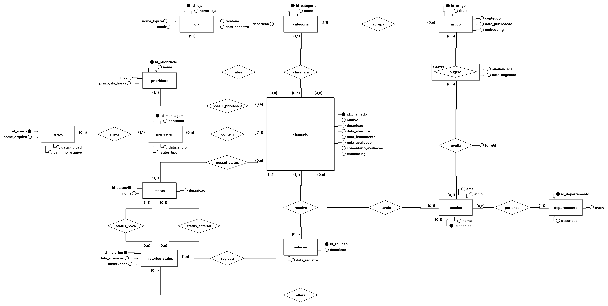
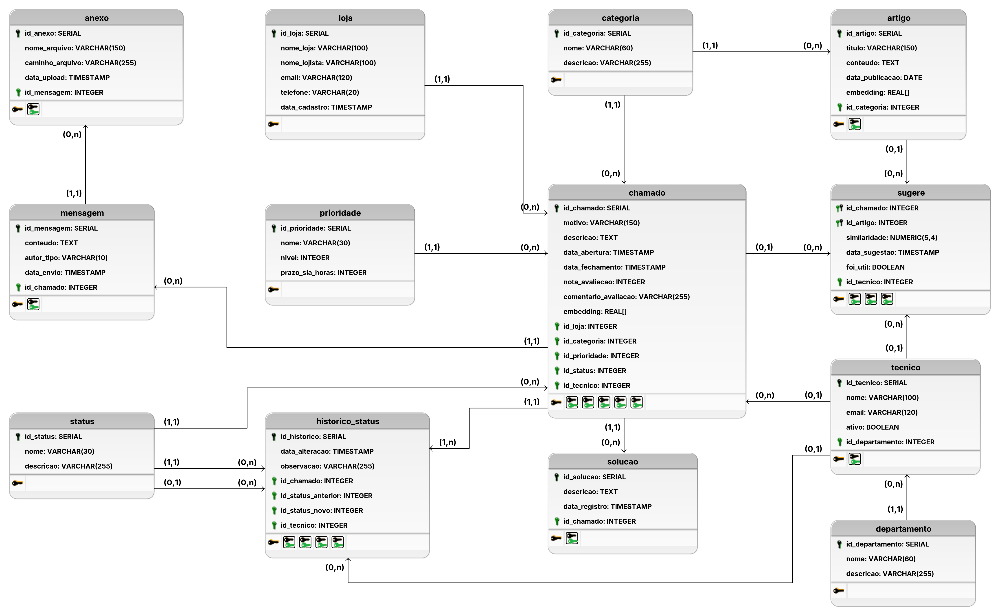

<h1 align="center">SmarTech — Sistema Inteligente de Chamados Técnicos</h1>

<p align="center">
  
  
  
  
  
</p>

## Sobre

Sistema de helpdesk para lojistas de e-commerce que gerencia o ciclo completo de um chamado técnico: abertura, atendimento, histórico de status, solução e avaliação. Utiliza embeddings gerados localmente pelo Ollama e busca por similaridade no PostgreSQL para sugerir artigos da base de conhecimento e chamados semelhantes já resolvidos.

Trabalho final da disciplina Banco de Dados (DEC7588) — UFSC Araranguá.

## Modelagem

### Modelo conceitual

<p align="center"></p>

### Modelo lógico

<p align="center"></p>

Os arquivos editáveis do brModelo estão em `img/modelo_conceitual.brM3` e `img/modelo_logico.brM3`.

## Inteligência artificial

Chamados e artigos são convertidos em embeddings (`nomic-embed-text`, 768 dimensões) e armazenados em colunas `REAL[]`. A similaridade é calculada pela função SQL `similaridade_cosseno`, e as sugestões ficam registradas na tabela `sugere`, onde o técnico indica se foram úteis.

## Como executar

Pré-requisitos: Node.js 18+, PostgreSQL e [Ollama](https://ollama.com/download).

```bash
git clone https://github.com/murilorochars/projeto-bd-final-4fase.git
cd projeto-bd-final-4fase
npm install
ollama pull nomic-embed-text
```

Crie um banco vazio chamado `smartech`, ajuste as credenciais em `bd/db.js` e execute:

```bash
npm run dev
```

No menu, use a opção **1** para criar as tabelas e a **3** para carregar os dados iniciais.

## Autores

Murilo Rocha da Rosa · Pedro Antonio Leão
